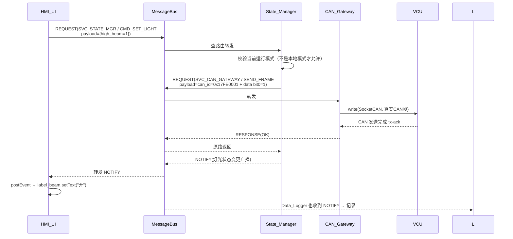

# 02 — 目标架构（4 节点微服务）

## 2.1 节点拓扑

```mermaid
flowchart LR
    subgraph 同一工控机内Unix Domain Socket通信
        UI[HMI_UI<br/>(Qt Widgets<br/>纯展示/交互)]
        BUS[MessageBus<br/>(Master节点<br/>服务注册+路由+心跳)]
        CAN[CAN_Gateway<br/>(纯C++ epoll<br/>唯一硬件入口)]
        STM[State_Manager<br/>(状态机+故障诊断+参数)]
        LOG[Data_Logger<br/>(异步记录<br/>SQLite/CSV)]
    end

    UI <-->|REQ/NOTIFY| BUS
    CAN<-->|REQ/NOTIFY| BUS
    STM<-->|REQ/NOTIFY| BUS
    LOG<-->|订阅所有NOTIFY| BUS

    CAN ---|SocketCAN| V[vcan0 / can0 车载总线]
    STM ---|跨机扩展TCP| GW[SomeIpGateway<br/>车云通信网关]
    GW ---|4G/5G| Cloud[云端调度/OTA]
```

## 2.2 节点职责表

| 节点 | 进程 | 技术栈 | 核心职责 | 崩溃影响 |
|---|---|---|---|---|
| **HMI_UI** | `cabpad_ui` | Qt 6 Widgets | 纯UI渲染；按钮点击→`NodeClient.sendRequest`；订阅状态推送→postEvent→UI刷新 | 🔴 HMI不可用，但车辆硬件状态不回退 |
| **MessageBus** | `cabpad_bus` | 纯C++17 epoll | 所有节点的唯一交汇点：服务注册/路由/心跳清理 | 🟠 所有RPC暂停（心跳10秒内缓冲），重启后自动恢复 |
| **CAN_Gateway** | `cabpad_can` | 纯C++ epoll（不依赖Qt） | 唯一SocketCAN读写点；`RawCan` 收发 → 与 Bus 双向序列化转发 | 🟡 车辆操作失效，UI 显示"通信异常"（State_Manager 推送降级）|
| **State_Manager** | `cabpad_state` | 纯C++17 | 维护状态机：IDLE/CONNECTING/RUNNING/FAULT；聚合车辆状态+故障；心跳看门狗 | 🟡 参数/状态显示冻结，但 UI 可操作（CAN命令可降级直连Gateway） |
| **Data_Logger** | `cabpad_log` | 纯C++17 + SQLite C API | 订阅全部 NOTIFY → 内存环形缓冲 → 批量 flush；不阻塞主链路 | 🟢 无影响（仅丢日志，事后重放） |

## 2.3 典型控制流（以"用户在 UI 点击远光灯开"为例）



## 2.4 为什么用 UDS 而不是共享内存 / D-Bus / ROS2

| 方案 | 优点 | 缺点 | 选型结论 |
|---|---|---|---|
| **Unix Domain Socket + 自定义Header** | 延迟最低（不走网络栈）、零依赖、完全可控、车规级移植简单 | 需要手写服务发现/心跳 | ✅ **选它**（和CAN帧的"固定Header+Payload"心智一致） |
| D-Bus | 桌面Linux成熟 | 延迟高（~1ms级）、车载移植不稳定、bus-daemon又是单点 | ❌ |
| 共享内存 | 带宽最高 | 同步互斥复杂、无原生消息边界，RPC需要自己再封 | ❌（日志高吞吐时可作为补充）|
| ROS2 / CycloneDDS | 功能全生态好 | 体积大（>20MB）、工控嵌入式裁剪麻烦、团队学习成本高 | ❌ |
