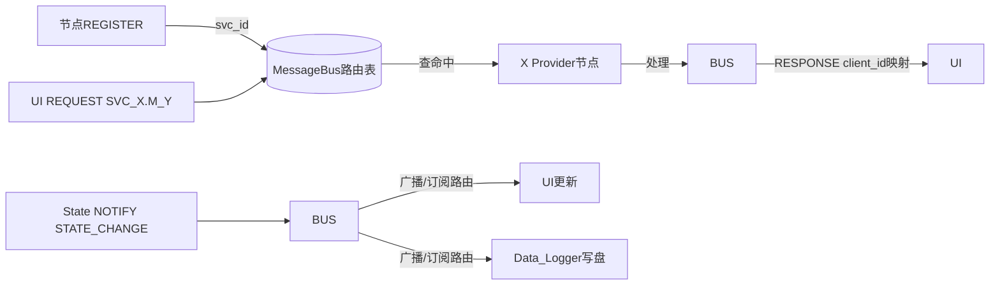

# 03 — IPC 协议设计（类 SOME/IP 25 字节 Header）

## 3.1 Header 格式（所有节点间通信共用）

| 偏移 | 字节 | 字段 | 说明 |
|---|---|---|---|
| 0  | 4 | magic      | 固定 `0xABCDEF01`，校验错位/丢包 |
| 4  | 4 | service_id | 服务ID（见 3.3） |
| 8  | 4 | method_id  | 方法ID（见 3.3） |
| 12 | 4 | length     | payload字节数，最大 65535 |
| 16 | 4 | client_id  | 流水号，Request↔Response匹配用 |
| 20 | 1 | msg_type   | 0x00 REQUEST 0x02 RESPONSE 0x04 NOTIFY 0x08 REGISTER 0x10 HEARTBEAT |
| 21 | 1 | error_code | 0x00 OK 0x01 NOT_READY 0x02 NOT_FOUND 0x03 TIMEOUT 0x05 SERVICE_UNAVAILABLE |
| **22-24** | **3** | （**预留**，对齐25字节） | 未来扩展 checksum / flags |

> C++结构体：`vipc::Header`（`__attribute__((packed))`）

## 3.2 字节序

**一律大端（网络序）**：`can_id` 等多字节整数在 payload 中统一 `uint8_t[4]` BE 编码。

## 3.3 ServiceID / MethodID 清单（精简）

完整枚举见 `VehicleIpcBus/include/vipc/ServiceIds.h`，核心摘录：

### SVC_CAN_GATEWAY (0x00000001)

| Method | 方向 | Payload |
|---|---|---|
| SEND_FRAME (1)    | HMI/State → GW | `can_id[4B] + data[≤8B]` |
| NOTIFY_RECV_FRAME (2) | GW → All订阅者 | `can_id[4B] + data[8B]` |
| SEND_DISCONNECT (3) | → GW | 空 |
| SEND_MAP_BUILD (4)  | → GW | 空 |

### SVC_STATE_MGR (0x00000002)

| Method | 方向 | Payload |
|---|---|---|
| CMD_CONNECT_CAR (1) | UI→State | `car_index[1B]` |
| CMD_SET_MODE (3)    | UI→State | `mode[1B]` 0本地/1遥操/2自动 |
| CMD_SET_LIGHT (4)   | UI→State | `bitmap[1B]` bit0远光 bit1近光 bit2工作 bit7双闪 |
| NOTIFY_STATE_CHANGE (8) | State→All订阅者 | 自定义二进制：`VehicleStatus`（电机转速/车速/电压等） |
| NOTIFY_FAULT_CHANGE (9) | State→All订阅者 | 16字节故障位bitmap |

## 3.4 消息流向图

