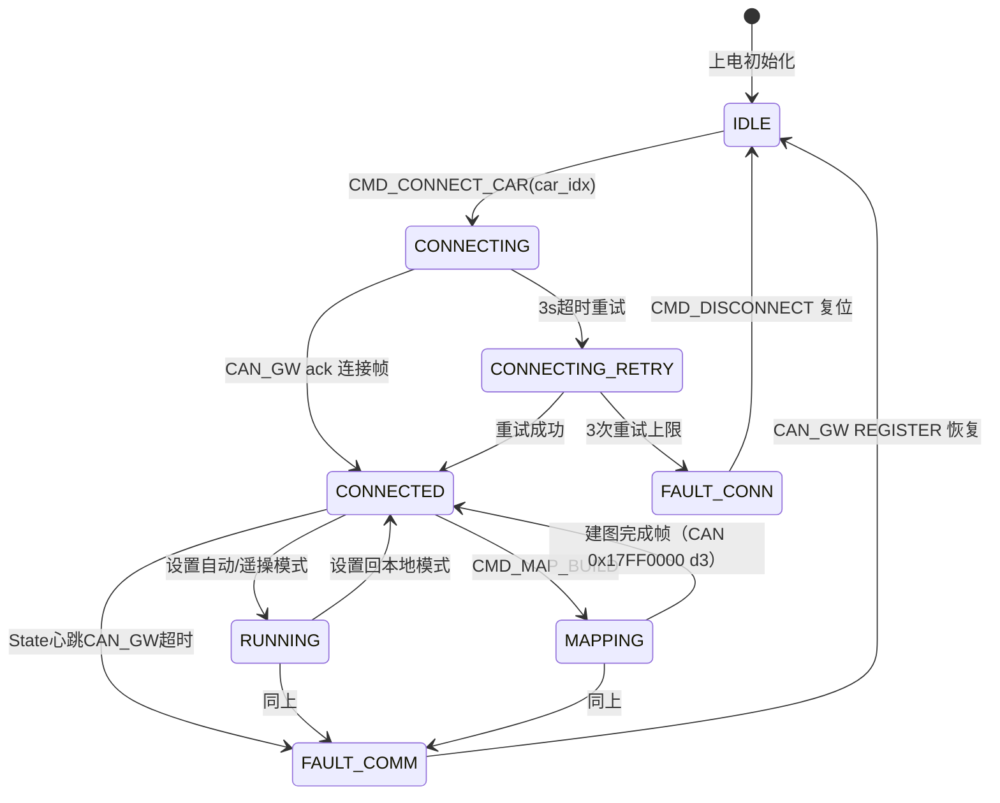

# 05 — 车辆状态机（State_Manager 核心）

## 5.1 状态定义



## 5.2 状态枚举（C++草案）

```cpp
enum class CarState : uint8_t {
    IDLE = 0,
    CONNECTING = 10,
    CONNECTING_RETRY = 11,
    CONNECTED = 20,
    MAPPING   = 30,
    RUNNING   = 40,
    FAULT_CONN = 0xE0,
    FAULT_COMM = 0xE1,
};
```

## 5.3 每个状态 → UI 约束

| 状态 | 允许的操作 | UI 表现 |
|---|---|---|
| IDLE | 仅 CONNECT_CAR、登录、管理员页 | 所有功能按钮灰显，"连接车辆"蓝显 |
| CONNECTING/RETRY | 仅取消 | 按钮loading转圈，进度条"正在握手 X/3" |
| CONNECTED | 灯光/液压锁/驻车/双闪/视角/建图/断开 | 首页"已连接"绿标，导航栏可进入页面 |
| MAPPING   | 取消建图 + 基础灯光 + 断开 | 顶部"建图中"橙色动画条 |
| RUNNING   | 所有控制 + 自动模式设置 | 控制页滑块/开关全部可用 |
| FAULT_*   | 仅断开 | 红色大横幅"通信异常 X 秒"，其余按钮灰显 |

## 5.4 故障诊断状态机（附属）

`FaultStatus bitmap[16]` 来自 `VehicleParser`：

- 每位 `1 → UI 红色图标`；**连续 3 次 CAN 读取均为 1 才触发告警**（防抖）
- `cabHeartbeatLost` 如果置 1 → 立即触发 FAULT_COMM（最高优先级）
