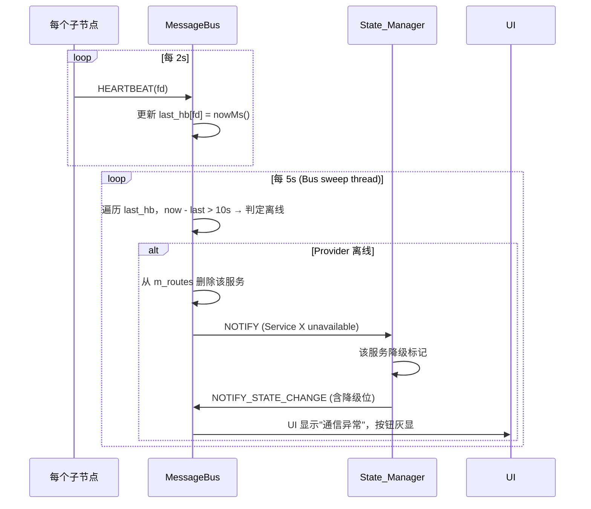

# 06 — 故障隔离方案（车规底线）

## 6.1 目标

> 任意一个节点崩溃 / 死循环 / 离线，**HMI_UI 绝不黑屏**，且 3 秒内给出明确降级提示；
> 节点恢复后，系统在 1 秒内自动恢复功能，无需用户手动重启界面。

## 6.2 心跳机制



## 6.3 节点异常 → 决策树（对应操作）

| 失效节点 | 判定方式 | State_Manager 操作 | HMI_UI 表现 | 恢复条件 |
|---|---|---|---|---|
| CAN_Gateway | 心跳超时 / FD挂起 | `car_state ← FAULT_COMM`；所有控制指令返回 SERVICE_UNAVAILABLE 或本地缓存 | 顶部红色横幅 + 控制按钮灰显 + 弹窗"CAN通信异常，已尝试自动重连 X/3" | CAN_GW 重新 REGISTER → State_Manager 收到 → `car_state ← IDLE` |
| State_Manager | UI 3次Request无Response | （UI侧判定）→ 降级为"直连模式"：UI 直接向 CAN_Gateway 发原始 SEND_FRAME | 横幅橙色"状态管理离线，仅基础控制可用"，诊断页不更新 | State_Manager REGISTER → UI 取消直连 |
| Data_Logger | 心跳超时 | 不影响业务 | 隐藏 UI 角落"记录中"图标 | 重新 REGISTER 即可 |
| MessageBus | 所有 NodeClient 检测到 socket EOF | 每个节点内置指数退避重连（1s→2s→4s→…→30s） | 全屏遮罩"总线重连中 X 秒"（但控件不删内存）| socket 重新建立 → 节点 REGISTER 全部重新广播 |

## 6.4 崩溃自恢复（生产部署）

**systemd 配置**（/etc/systemd/system/cabpad-*.service）：

```ini
[Unit]
Description=CabPad CAN Gateway
After=network.target cabpad-bus.service
Requires=cabpad-bus.service

[Service]
Type=simple
ExecStart=/opt/cabpad/bin/cabpad_can /tmp/cabpad_bus.sock
Restart=always
RestartSec=0.5
StartLimitBurst=5
StartLimitIntervalSec=30
WatchdogSec=15       # systemd 看门狗：15s 不 sd_notify(READY=1) 自动 kill

[Install]
WantedBy=multi-user.target
```

## 6.5 测试矩阵（必须全部通过）

| 测试用例 | 操作方法 | 期望结果 |
|---|---|---|
| T1 | `kill -9 cabpad_can` | UI 3秒内横幅"CAN异常"，不黑屏；systemd 500ms拉起，2秒内恢复 |
| T2 | `kill -9 cabpad_bus` | 所有节点显示"总线重连"；bus重启后所有节点自动 REGISTER；10秒内UI完全可用 |
| T3 | `kill -9 cabpad_state` | 诊断页冻结但控制仍可用（直连CAN）；state恢复后数据补全 |
| T4 | `kill -9 cabpad_ui` | 此为最严重场景：systemd 2s内重启HMI，用户重新登录，其余节点无感 |
| T5 | CAN总线插拔（物理断开30s再插上）| CAN_GW 显示"BUS OFF"灰显，恢复后自动回到 RUNNING |
